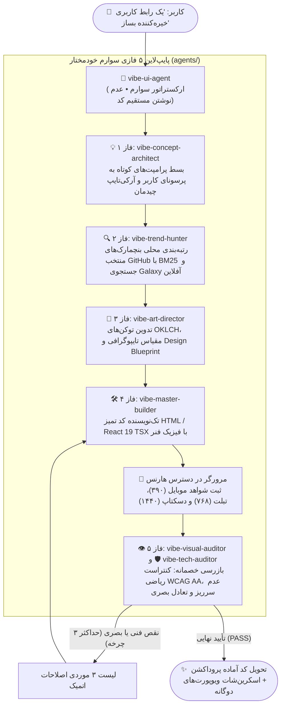

<div align="center">


# اکوسیستم Vibe UI Suite

**مهندسی قراردادمحور فرانت اند، قیدهای دیزاین سیستم و موتور اعتبارسنجی ران تایم برای دستیاران کدنویسی هوش مصنوعی.**

[](https://github.com/omid-io/vibe-ui-suite/actions/workflows/ci.yml)
[](https://www.npmjs.com/package/vibe-ui-suite)
[](https://www.npmjs.com/package/vibe-ui-suite)
[](https://open-vsx.org/extension/omid-io/vibe-ui-vscode)
[](https://marketplace.visualstudio.com/items?itemName=omid-io.vibe-ui-vscode)
[](https://github.com/omid-io/vibe-ui-suite)
[](LICENSE)
[](evals/)

<p align="center">
  <a href="README.md"><strong>English Documentation</strong></a> •
  <a href="ARCHITECTURE.md"><strong>مستندات معماری سیستم</strong></a> •
  <a href="docs/ENTERPRISE_ADAPTATION.md"><strong>راهنمای تطبیق سازمانی</strong></a> •
  <a href="https://omid-io.github.io/vibe-ui-suite/"><strong>استودیوی تعاملی کامپایلر آنلاین</strong></a>
</p>

</div>

---

## ⚖️ مقایسه خروجی: هوش مصنوعی معمولی در برابر شاهکار Vibe UI

وقتی از یک هوش مصنوعی معمولی می خواهید کامپوننت فرانت اند تولید کند، چه تفاوتی رقم می خورد؟

```text
┌──────────────────────────────────────┐  در  ┌──────────────────────────────────────┐
│ ❌ خروجی کلیشه ای AI (Vanilla Slop)  │ برابر│ ✨ خروجی شاهکار Vibe UI              │
├──────────────────────────────────────┤      ├──────────────────────────────────────┤
│ • دکمه های تکراری با گرادیان بنفش   │      │ • اولویت بوم روشن و لایه بندی عمق    │
│ • کنتراست ضعیف متن (۳.۲ به ۱ - مردود)│      │ • کنتراست ریاضی WCAG 2.2 AAA (۱۸.۸)  │
│ • سوگیری تنبل به سمت بوم تاریک       │      │ • ویدیوهای امبینت در سبک های خلاقانه │
│ • اموجی های متنی زرد و آماتور        │      │ • آیکون های برداری شفاف و SVG تمیز   │
│ • کارت های استاتیک و بدون تعامل      │      │ • کدهای زنده React 19 با تم دوگانه   │
│ • خروجی عجله ای و تخت و بی روح       │      │ • معماری الگو-محور (دریبل و فیگما)   │
│ • تصاویر خالی و لینک های شکسته       │      │ • گنجینه عکس های Unsplash در ۲۴ حوزه  │
│ • سرریز افقی در موبایل (۳۹۰ پیکسل)   │      │ • اسکرین شات هدلس در چند ویوپورت     │
│ • به هم ریختگی ترکیب فارسی و انگلیسی  │      │ • ایزولاسیون BiDi و RTL برحسب تقاضا │
└──────────────────────────────────────┘      └──────────────────────────────────────┘
```

👉 **[استودیوی کامپایلر طراحی آنلاین را زنده امتحان کنید](https://omid-io.github.io/vibe-ui-suite/)** — بدون تاخیر سرور، استنتاج آنی سمت کاربر و پیش نمایش بلادرنگ کامپوننت ها.

---

مجموعه **Vibe UI Suite** چارچوبی ساختاریافته، ماشین فهم و قابل سنجش در اختیار ادیتورها و ایجنت های هوش مصنوعی (Cursor، Claude Code، Windsurf و Antigravity) قرار می دهد تا رابط های کاربری را با اصول واقعی مهندسی فرانت اند طراحی، پیاده سازی و اعتبارسنجی کنند.

به جای اتکا به پرامپت نویسی شکننده («یک داشبورد شیک و مدرن بساز»)، این سیستم یک پایپ لاین صریح مشابه کامپایلر ایجاد می کند:

```text
قصد و خواسته کاربر
    ↓
بسط نیت و خواسته (قرارداد ۶ بعدی • مشخصات P01 تا P30)
    ↓
اسکیمای ماشین فهم (design-spec.v1.schema.json)
    ↓
انتخاب کهن الگوی کلان (مخزن ۷ کهن الگوی دیزاین)
    ↓
پیاده سازی کد (Next.js 15 / React 19 TSX / Tailwind OKLCH)
    ↓
ارزیابی استاتیک (اسکیما، ریاضیات کنتراست، تست های منفی)
    ↓
ارزیابی زنده با مرورگر در دسترس هارنس (موبایل ۳۹۰، تبلت ۷۶۸ و دسکتاپ ۱۴۴۰ پیکسل)
    ↓
خروجی تست شده یا گزارش دقیق خطاهای مهندسی
```

> **شفافیت روز نخست:** این پروژه استوار بر ستون ۱ (الهام آفلاین و تکرارپذیر بر پایه رتبه‌بندی BM25 روی Design Genome نسخه‌بندی‌شده و داده‌های منتخب بنچمارک‌ها؛ بدون استخراج زندهٔ ستاره‌های GitHub یا خزش سایت‌های ترند با پیش فرض تم روشن سرزنده و مدرن) و ستون ۲ (اعتبارسنجی بصری و فنی با مرورگر در دسترس هارنس در موبایل ۳۹۰px، تبلت ۷۶۸px و دسکتاپ ۱۴۴۰px؛ خود پکیج هیچ مرورگر یا درایوری نصب و اجرا نمی‌کند)، موتور الهام بخش گالکسی با بیش از ۳,۸۰۰ المان و کش آفلاین، گنجینه عکس های باکیفیت Unsplash پوشش دهنده تمامی ۲۴ حوزه تخصصی با لینک های آزموده شده CDN، کاتالوگ کامپوننت ها و بلاک های کامل سکشن، ممیزی تایپ اسکریپت با `audit`، سرور ابزار هوش مصنوعی `mcp`، تولید مستقیم کامپوننت های زنده React 19 TSX با فلگ `-f tsx`، و هماهنگی کامل ابزارها در npm، پایتون CLI و افزونه VS Code است. از نقدها، باگ ریپورت ها و مشارکت های مهندسان فرانت اند صمیمانه استقبال می کنیم.

---

## 👑 معماری خودمختار سوارم چند ایجنتی

> **حذف میانبر تک‌مدلی (Solo Shortcut):** وقتی یک مدل هوش مصنوعی به تنهایی تلاش می‌کند همزمان ایده‌پردازی کند، بنچ‌مارک ببیند، کد بنویسد و تست کند، گرفتار سوگیری تأیید و کدهای بی‌کیفیت و کلیشه‌ای می‌شود.  
> این پلتفرم معماری **سوارم چند ایجنتی یکپارچه** به رهبری `vibe-ui-agent` ([AGENT.md](vibe-ui-agent/AGENT.md)) را معرفی می‌کند: خط تولید ۵ فازی کاملاً مستقل که در آن ارکستراتور کل بدون نوشتن مستقیم کد، وظایف را بین ۵ ایجنت متخصص توزیع و تضمین کیفیت خصمانه را مدیریت می‌کند.



### ⚡ اجرای تک‌خطی سوارم (Swarm Quickstart)
اجرای بی‌درنگ کل سوارم از طریق ترمینال، Cursor، Claude Code یا Antigravity:

```bash
# اجرای مستقیم با npx بدون نیاز به نصب
npx vibe-ui-suite swarm "Modern Dark Luxury Real Estate Showcase"

# یا از طریق پایتون CLI
python vibe_cli.py swarm "High-velocity AI developer platform" -o landing.html
```

### 🏛️ نقش‌های تخصصی درون سوارم (`agents/`)
تمام ایجنت‌ها به عنوان مشخصات مستقل و پرتابل در پوشه `agents/` تعریف شده‌اند:
- **`vibe-ui-agent`**: ارکستراتور کل سوارم. وظیفه هدایت و پیشبرد فازها را بر عهده دارد و طبق قانون قطعی **Zero Direct Code Writing** هرگز مستقیماً در چت کد نمی‌نویسد.
- **`vibe-concept-architect`** (فاز ۱): حلال پرامپت‌های تنبل با تشخیص دقیق دامنه محصول، روانشناسی مخاطب و کهن‌الگوی چیدمان.
- **`vibe-trend-hunter`** (فاز ۲): رتبه‌بندی داده‌های محلی بنچمارک‌های GitHub با BM25 و جستجوی ۳,۸۰۰ المان تعاملی Galaxy به‌صورت آفلاین؛ مقادیر ستاره‌ها دادهٔ ذخیره‌شده‌اند، نه آمار زندهٔ GitHub.
- **`vibe-art-director`** (فاز ۳): تدوینگر سند الزام‌آور `Design Style Blueprint` بر پایه پالت‌های مدرن OKLCH و سلسله‌مراتب فونت.
- **`vibe-master-builder`** (فاز ۴): تنها نویسنده کد، مجری کامپوننت‌های بدون درز HTML / React 19 TSX با فیزیک فنر.
- **`vibe-visual-auditor` و `vibe-tech-auditor`** (فاز ۵): بازرسان سخت‌گیر کیفیت با بررسی کنتراست ریاضی، سرریز ۰ پیکسل موبایل و هماهنگی فضایی.

### 🌐 قابلیت حمل همه‌جانبه (Multi-Harness Portability)
این پلتفرم برای تمامی محیط‌های اصلی هوش مصنوعی با قابلیت شناسایی بومی بازطراحی شده است:
- **Antigravity**: به عنوان پلاگین محلی پروژه در `.agents/plugins/vibe-ui/` با رجیستری داینامیک `define_subagent`.
- **Claude Code**: شناسایی بومی ساب‌ایجنت‌ها از مسیر `.claude/agents/`.
- **Cursor و Windsurf**: راهبری مستقیم محیط توسعه از طریق ریشه `AGENTS.md`.
- **پکیج NPM**: عرضه همگانی همراه با تمام ایجنت‌ها در بسته دانلودی `agents/`.

---

### جریان اول: ساخت از صفر (پرامپت ۱-خطی و تنبل)
کافی است فقط یک جمله به زبان ساده به دستیار خود (Cursor، Claude Code، Windsurf، Copilot، Antigravity) بگویید:

```text
@vibe-ui-agent برای پروژه من یک صفحه لندینگ مدرن و کاربرپسند طراحی کن.
```

**اشاره اختیاری به سبک یا موضوع (هرگز اجباری نیست):**
- `@vibe-ui-agent یک داشبورد مالی و آمار کاربران با سبک روان اپل کوپرتینو پیاده سازی کن`
- `@vibe-ui-agent یک صفحه معاملات رمزارز با ظاهر دارک و ترمینالی بساز`
- `@vibe-ui-agent یک فرم نوبت دهی شیک برای کلینیک زیبایی طراحی کن`

**تضمین های خودکار vibe-ui-agent (پروتکل پرامپت تنبل و گیت های ۵ گانه):**
- **بازبینی بصری اجباری با اسکرین شات:** استفاده از مرورگر موجود در هارنس برای بررسی رابط قبل از تغییرات ساختاری؛ پکیج هیچ مرورگر یا درایوری نصب یا اجرا نمی‌کند.
- **انتخاب هوشمند پارادایم معماری:** گزینش سبک با تکیه بر Design Genome محلی، بلوپرینت‌های دامنه و داده‌های منتخب مخازن متن‌باز. Trend Hunter فعلی از Dribbble، Mobbin، Figma Community، Awwwards یا تعداد ستاره‌های زندهٔ GitHub داده‌برداری نمی‌کند.
- **تحول ساختاری چیدمان و ریتم فضایی:** بازآفرینی واقعی ساختار DOM و ریتم ۸ پیکسلی به جای تغییرات سطحی (ممنوعیت مطلق تغییرات صرفاً آرایشی).
- **تزریق کامپوننت های زنده و رسانه های غنی:** بهره گیری از میکرواینتراکشن های حرکتی Galaxy (دکمه شیمر، تاگل فیزیکی، لودر سایبر)، عکس های مستند Unsplash و ویدیوهای امبینت متناسب با صفحات لندینگ و پروژه های خلاقانه.
- **استانداردهای بهداشتی خاموش (Table-Stakes):** محاسبات رنگی OKLCH، کنتراست ریاضی WCAG AAA، جایگزینی کامل اموجی ها با SVG، و ایزولاسیون bdi به طور نامرئی در لایه ورکر انجام شده و گزارش را شلوغ نمی کنند.

---

### جریان دوم: جراحی ساختاری و نجات رابط کاربری زشت (Structural Redesign)
هنگامی که یک کامپوننت یا صفحه دارید اما ظاهر آن بی کیفیت، کلیشه ای یا به هم ریخته است (چیدمان های مرده، کارت های فشرده، یا عدم وجود سلسله مراتب بصری):

```text
@vibe-ui-agent این صفحه خیلی شلوغ و آماتور شده؛ با استانداردهای ساختاری Vibe UI از نو طراحیش کن.
```

**فرایند کاملاً خودکار ایجنت در چند گام:**
1. بررسی وضعیت فعلی رابط با مرورگر موجود در هارنس و ثبت شواهد بصری و خطاهای اجرایی.
2. تخریب اسکلت مرده قبلی و پیاده سازی ساختار بنتو گرید مدرن یا استایل مینیمال متناسب با کاربرد صفحه.
3. بازچینی دکمه ها، فیلدها و کارت ها با کامپوننت های زنده حرکتی بدون آسیب به عملکردهای بیزینسی.
4. ثبت اسکرین‌شات در ابعاد ۳۹۰، ۷۶۸ و ۱۴۴۰ پیکسل، بازبینی آن‌ها با مدل بینایی و اعتبارسنجی گزارش متصل به SHA-256 فایل نهایی.
5. ارائه گزارش معطوف به تحول معماری و ریتم فضا بدون ذکر جزییات پیش پا افتاده نظیر تعویض اموجی یا تغییر هگز.

---

### جریان سوم: راه اندازی خودکار پروژه بدون نیاز به ترمینال
هنگام آغاز به کار روی یک پروژه جدید، بدون نیاز به باز کردن پاورشل یا ترمینال:

```text
پکیج vibe-ui-suite را در پروژه نصب و پیکربندی کن و قوانین vibe-ui-agent را فعال نما.
```

**اقدامات کاملاً خودکار ایجنت:**
1. اجرای دستور `npm install vibe-ui-suite` در ترمینال پروژه.
2. اضافه کردن خط `@import "vibe-ui-suite/v4.css";` به فایل اصلی استایل (`app/globals.css` یا `src/index.css`).
3. ایجاد فایل قوانین ادیتور (`.cursorrules` یا `CLAUDE.md` یا `AGENTS.md`) با دستورالعمل های کامل vibe-ui-agent.

---

### 🎨 ۸ کهن الگوی کلان دیزاین (انتخاب هوشمند یا به دلخواه شما)
نیازی نیست سبکی را حفظ کنید—`vibe-ui-agent` با توجه به حوزه کاری پروژه، بهترین سبک را از **مخزن الگوهای دیزاین** (`data/design_vault/archetypes.json`) انتخاب می کند. با این حال می توانید به هر یک از کهن الگوها اشاره کنید:

| کهن الگوی کلان | فلسفه طراحی | فیزیک سطوح و نورپردازی | بهترین کاربرد |
| :--- | :--- | :--- | :--- |
| **`Linear Dev HUD`** | بوم های ابسیدین تیره، تلمتری ترمینال های میکرو، فونت های مونو | هاله نوری فیروزه ای و زمردی، خطوط مویی آینه ای، اسپارک لاین K8s | زیرساخت ابری، ابزارهای توسعه، سیستم های مانیتورینگ |
| **`Swiss Editorial`** | سلسله مراتب تایپوگرافی نامتقارن، وقار مجله ای سوئیسی | کنتراست مونوکروم دقیق، خطوط مویی راهنما، تعادل سریف و سنس | نشریات، مد و پوشاک، معماری، استودیوهای لوکس |
| **`Cupertino Glass`** | شیشه مات چندلایه، گوشه های نرم اسکوئرکل، انیمیشن های فنری سیال | عمق محیطی، سطوح مایع شیشه ای، بازخوردهای لمسی بهینه | استارتاپ های مدرن، وب اپلیکیشن های موبایل، سلامت |
| **`Full-Bleed Bento`** | گرید ۴ خانه بنتو نامتقارن، وزن های بصری متغیر، اسپارک لاین پویا | های لایت های مویی در لبه بالا، رادیانس نوری ردگیری ماوس | پلتفرم های هوش مصنوعی، ابزارهای خلاقانه سازمانی |
| **`Quiet Luxury`** | پالت های گرم سنگ و شامپاینی، ظرافت سریف، دقت کلینیکال | اسلایدرهای درگ تعاملی قبل و بعد، نشان های اصالت و سرتیفیکیت | کلینیک های دندانپزشکی و زیبایی، فروشگاه های لوکس |
| **`Cyber Terminal`** | فسفر سبز و کهربایی رترو-فیوچریستیک، اسکن لاین، چگالی اطلاعاتی بالا | ماتریس هاد مونو، نشانگرهای وضعیت زنده، حداقل حاشیه نویسی | وب۳، سیستم های ممیزی امنیت، اینترفیس های سخت افزاری |
| **`Centered Stage`** | ارائه تکی محصول در مرکز، تایپوگرافی بزرگ و درشت، استیج معلق سه بعدی | مخروط هاله نوری شعاعی عمیق، شبکه مشبک ۳۶ پیکسلی پس زمینه | لندینگ پیج های با نرخ تبدیل بالا، رونمایی محصولات |
| **`Monochrome Laser Mint`** | بوم های فوق تیره گرافیتی، تلمتری سبز لیزری و فیروزه ای، سریف مجله ای | خطوط مویی ۲۷۲۷۲a#، تلمتری 00f5a0#، ابسیدین عمیق 09090b# | سیستم های مالی سرعت بالا، وب۳، ابزارهای امنیت توسعه |

---

### تولید خودکار اینترفیس از طریق ترمینال (`vibe_cli.py`)
تولید مستقیم اپلیکیشن های کامل و خودکفای وب یا کامپوننت های ماژولار React 19 از طریق خط فرمان:

```bash
# ۱. تولید فایل خودکفای HTML شاهکار با اسلایدرهای تعاملی و هیرو macOS:
python vibe_cli.py generate "یک سایت کلینیک زیبایی با رزرو آنلاین و نمونه کارهای قبل و بعد" -o clinic.html

# ۲. تولید کامپوننت زنده React 19 / TypeScript (.tsx) با هوک های استیت:
python vibe_cli.py generate "A modern developer observability dashboard with latency metrics" -f tsx -o DevDashboard.tsx

# ۳. ارزیابی و ممیزی هر فایل تولید شده بر اساس استانداردهای ممیزی پروداکشن:
python vibe_cli.py verify clinic.html

# ۴. بررسی استاتیک زیر ثانیه ای و ممیزی توکن ها (عدم تراز ۲ پیکسلی و رنگ ها):
python vibe_cli.py inspect clinic.html
```

---

### روش جایگزین: ویزارد تعاملی ترمینال (CLI)
اگر ترجیح می دهید از طریق منوی تعاملی ترمینال پروژه را آماده کنید:
```bash
npx vibe-ui-suite init
```
این دستور فایل قوانین ادیتور، استایل های پیش فرض و تم انتخابی شما را به صورت خودکار پیکربندی می کند.

---

## 🎨 سازگاری بومی با Tailwind CSS v4 (@theme) — بدون نیاز به کانفیگ

در فایل `app/globals.css` یا استایل شیت اصلی پروژه:
```css
@import "tailwindcss";
@import "vibe-ui-suite/v4.css";
```
بدون نیاز به نوشتن حتی یک خط فایل کانفیگ جاوااسکریپتی، کلاس های زیر فوراً فعال می شوند:
- **رنگ های معنایی OKLCH:** `bg-vibe-canvas`, `bg-vibe-surface`, `text-vibe-primary`, `border-vibe-border`
- **منحنی های فیزیک حرکت:** `ease-vibe-spring`, `ease-vibe-snap`, `ease-vibe-glide` (یا کلاس `.vibe-spring`)
- **سایه های متریال:** `shadow-vibe-brutal`, `shadow-vibe-glass`

---

## 📦 تزریق کامپوننت های تست شده هوش مصنوعی (`add`)

کامپوننت های آماده و دسترسی پذیر را مستقیماً داخل پوشه `components/vibe-ui/` پروژه خود دریافت کنید:
```bash
# المان های پایه و تله متری هوش مصنوعی:
npx vibe-ui-suite add thinking-drawer
npx vibe-ui-suite add telemetry-hud
npx vibe-ui-suite add contrast-badge
npx vibe-ui-suite add theme-toggle

# بلاک های کامل سکشن:
npx vibe-ui-suite add bento-hero
npx vibe-ui-suite add pricing-matrix
npx vibe-ui-suite add feature-grid
npx vibe-ui-suite add glass-navbar
npx vibe-ui-suite add conversion-cta
npx vibe-ui-suite add faq-accordion

# میکرواینتراکشن های زنده:
npx vibe-ui-suite add shimmer-button
npx vibe-ui-suite add cyber-loader
npx vibe-ui-suite add holographic-card
npx vibe-ui-suite add tactile-switch
npx vibe-ui-suite add glow-input

# ممیزی مستقیم فرانت اند بدون وابستگی به پایتون:
npx vibe-ui-suite audit src/App.tsx

# راه اندازی سرور پروتکل ابزار هوش مصنوعی (MCP):
npx vibe-ui-suite mcp
```
مشاهده فهرست تمام کامپوننت های موجود:
```bash
npx vibe-ui-suite list
```

---

## 🌌 موتور الهام بخش گالکسی (`inspire`)

دسترسی آنی به آرشیو غنی بیش از ۳,۸۰۰ المان تعاملی، انیمیشن ها و کارت های مدرن با کش خودکار آفلاین و سرعت زیر ۱۰ میلی ثانیه:
```bash
# جستجو در میان کامپوننت های کامیونیتی با کش پرسرعت آفلاین:
python vibe_cli.py inspire "neon cyber button"
python vibe_cli.py inspire "holographic card" -l 3

# یا از طریق پکیج npm:
npx vibe-ui-suite inspire "orbit loader"
```

---

## 💻 افزونه ادیتورها (VS Code & Cursor)

افزونه رسمی Vibe UI مستقیماً در سایدبار ادیتور شما فعال است:

- **VS Code Marketplace:** [`omid-io.vibe-ui-vscode`](https://marketplace.visualstudio.com/items?itemName=omid-io.vibe-ui-vscode)
- **Open-VSX Registry:** [`omid-io.vibe-ui-vscode`](https://open-vsx.org/extension/omid-io/vibe-ui-vscode) (مخصوص Cursor، Windsurf، VSCodium)

### امکانات افزونه:
- **ماشین حساب زنده کنتراست WCAG 2.2:** محاسبه آنی و ریاضیاتی نسبت روشنایی ($L_1 / L_2$) با انتخاب رنگ و نمایش زنده وضعیت قبولی AA و AAA.
- **درج ۱-کلیک کامپوننت:** کلیک روی دکمه **Insert into Active Editor** برای نوشتن کد کامپوننت در موقعیت مکان نما.
- **دستور بررسی سریع فایل:** با فشردن `Ctrl+Shift+P` و اجرای `Vibe UI: Audit Active File Contrast`.

---

## 🏛️ معماری: پایپ لاین هماهنگی ۶ مهارت تخصصی

هماهنگی فرآیندها توسط ایجنت معمار ارشد فرانت اند (**`vibe-ui-agent`**) انجام می شود که ۶ ساب اسکیل تخصصی را هدایت می کند:

| مهارت تخصصی | نقش و محدوده وظایف | قید و مکانیزم اصلی |
| :--- | :--- | :--- |
| **`autonomous-intent-expander`** | بسط پرامپت با بودجه ابهام زدایی کالیبره شده | پرهیز از حدس زدن الزامات کسب وکار و تبدیل به قرارداد ۳۰ پارامتری |
| **`visual-chemistry-engine`** | انتخاب سیستم زیبایی شناسی یکپارچه | ۵ استایل متمایز با قانون جلوگیری از شباهت به وبسایت های قبلی |
| **`ui-kit`** | کامپوننت ها و الگوهای تعاملی هوش مصنوعی | دراور پردازش فکر، چیپ ابزارها، هاد تله متری، الگوهای بنتو |
| **`vibe-physics-engine`** | فیزیک انیمیشن، رنگ های ادراکی و بودجه GPU | فضای رنگی OKLCH، منحنی اسپرینگ، سقف حداکثر ۳ لایه بلور |
| **`conversion-copy-engine`** | روایت ارزش و سناریوی شفاف محصول | متن های داده محور؛ ممنوعیت اکید نظرات ساختگی و فوریت فیک |
| **`ui-verifier`** | گیت های اعتبارسنجی کیفیت و دسترس پذیری | محاسبات استاتیک + تست زنده DOM در مرورگر پلی رایت |

---

## 🎨 هشت کهن‌الگوی بصری رسمی (The Eight Visual Chemistries)

سیستم طراحی Vibe UI بر پایه ۸ سبک بصری استاندارد و تثبیت‌شده عمل می‌کند:

1. **مینیمال نرم‌افزاری (Minimalist SaaS):** انضباط مونوکروم، خطوط مرزی دقیق، تراکم بالای اطلاعات و تایپوگرافی خوانا (`oklch(0.12 0.01 260)`).
2. **شیشه‌ای لوکس (Luxury Glassmorphism 2.0):** لایه‌های بلور مات چندگانه، رفلکس‌های براق فرنل، خطوط طلایی ظریف و تاریکی مخملی (`oklch(0.08 0.02 270)`).
3. **نئوبروتالیسم (Neobrutalism):** کارت‌های اشباع با کنتراست بالا، سایه‌های سخت ۳-۴ پیکسلی مشکی بدون بلور و مرزبندی‌های فیزیکی مشخص.
4. **تحریریه سوئیسی (Swiss Editorial):** شبکه نامتقارن تایپوگرافی، فضای منفی فراخ، هماهنگی فونت‌های سریف/سنس برگرفته از سبک بین‌المللی سوئیس.
5. **روشن و شفاف استرایپ (Stripe Crisp Light):** استایل توسعه‌دهنده‌محور با پس‌زمینه‌های عاجی درخشان، گرادیان‌های لطیف و سایه‌های کنترل‌شده.
6. **روان اپل کوپرتینو (Apple Cupertino Fluid):** گوشه‌های کاملاً منحنی اسکویرکل (Squircle)، فیزیک نرم فنر و متریال‌های نیمه‌شفاف.
7. **عمق و حرکت سینمایی (Cinematic Motion & Depth):** پس‌زمینه شبانه عمیق (`#050508`)، ویدیوهای امبینت سبک و کنتراست بالای لایه‌های متنی.
8. **گرافیت مونوکروم و نعنایی لیزری (Monochrome Laser Mint):** بوم گرافیتی بسیار تاریک (`#09090b`)، رنگ‌های تلمتری نعنایی (`#00f5a0`) و سایان، ترکیب سنس هندسی و سریف ایتالیک.

---

## ⚡ استانداردهای حرکتی کینتیک وایب یو آی

یک تجربه فرانت اند حرفه ای و مدرن باید از نظر فیزیکی زنده، ملموس و واکنش گرا باشد. این پلتفرم ۶ اصل حرکتی را به صورت الزامی پیاده سازی می کند:

۱. **کرسر کینتیک پیکان و فیزیک دنبال کننده:**
   - مخفی سازی کامل کرسر پیش فرض سیستم عامل (`cursor: none !important`).
   - نقطه دقیق و بدون تاخیر با نور ملایم (`#vibeCursorDot`) با تعقیب یک به یک مختصات موس.
   - پیکان برداری SVG دنبال کننده (`#vibeCursorFollower`) با محاسبه زاویه دوران سرعت و اینرسی فنری (`Math.atan2`).
۲. **شبکه ماتریکس نقطه ای با نور اسپات لایت:**
   - نمایش گرید نقطه ای بوم که بر اساس موقعیت نشانگر موس با هاله نوری شعاعی (`radial-gradient`) روشن می شود.
۳. **ریل های متحرک افقی مارکی (Infinite Marquee):**
   - حرکت نرم و شتاب دهی سخت افزاری کارت ها و برچسب ها با `translate3d` و توقف خودکار هنگام هاور موس بدون اختلال در انیمیشن های اسکرول.
۴. **تصاویر ادیتوریال هوشمند (AssetDirector):**
   - تزریق مستقیم تصاویر واقعی، باکیفیت و متناسب با موضوع پروژه از Unsplash همراه با سیستم فال بک برداری SVG.
۵. **انیمیشن های مرحله ای ورود هنگام اسکرول (Stagger Scroll-Reveals):**
   - تحریک عناصر با IntersectionObserver همراه با تغییر همزمان شفافیت، موقعیت عمودی و حذف بلور.
۶. **لود تنبل و بلورزدایی تدریجی تصاویر (Lazy Blur-Up):**
   - انتقال تصویر از حالت بلور ملایم (`filter: blur(12px)`) به وضوح کامل بلافاصله پس از لود شدن.

---

## 🌐 اصل راست چین سازی معنادار با ساختار ثابت (Semantic RTL)

رابط های کاربری تولیدشده توسط هوش مصنوعی معمولاً با اعمال ناشیانه `dir="rtl"` دچار به هم ریختگی چیدمان، معکوس شدن منوهای ناوبری و وارونگی چارت ها می شوند.

قانون قطعی Vibe UI:
- **پایداری ساختار کلان:** ستون ها، سایدبار، نوبار و محور چارت ها ۱۰۰٪ ثابت و بدون جهش فیزیکی باقی می مانند.
- **RTL صرفاً روی محتوا:** جهت راست به چپ فقط روی پاراگراف ها، متون و عناوین با ویژگی های منطقی CSS (`margin-inline-start`) اعمال می شود.
- **ایزولاسیون دوزبانه (BiDi):** کدهای فنی، دستورات ترمینال، تله متری و آدرس های URL با تگ `<bdi>` یا `dir="ltr"` محافظت می شوند.

---

## 🧪 موتور ارزیابی و تست های ران تایم

```bash
# ۱. اجرای آزمون های استاتیک و تست های منفی
python evals/run_evals.py

# ۲. خروجی ماشین فهم جهت پایپ لاین های CI
python evals/run_evals.py --json

# ۳. آزمون زنده در مرورگر واقعی با پلی رایت
`vibe-ui-suite swarm`، سپس بررسی رابط با مرورگر هارنس، و در پایان اجرای دوبارهٔ همان دستور با `--verify-existing --browser-evidence .vibe/browser-evidence.json` و همان مسیر `--output`
```

### تفاوت آزمون های قطعی و تحلیلی:

| گیت کنترلی | ماهیت | روش ارزیابی | محدوده پوشش |
| :--- | :--- | :--- | :--- |
| **اعتبارسنجی اسکیما** | قطعی | اعتبارسنجی با Draft 2020-12 | تست قرارداد فنی با `additionalProperties: false` |
| **رد تست های منفی** | قطعی | بررسی کد خروج ۱ در ترمینال | رد آنتروپی غیرمجاز، کهن الگوی نامعتبر، تاچ تارگت زیر ۲۴px |
| **کنتراست WCAG AA** | قطعی | فرمول $L = 0.2126 R' + 0.7152 G' + 0.0722 B'$ | تضمین کنتراست $\ge 4.5:1$ برای متن و $\ge 3.0:1$ برای عناوین |
| **سرریز در موبایل** | ران تایم | اندازه‌گیری واقعی مرورگر ارائه‌شده توسط هارنس | اطمینان از عدم سرریز افقی (`scrollWidth <= clientWidth`) در ۳۷۵px و ۳۹۰px |
| **المان های کلیک پذیر** | استاتیک | پیمایش درخت DOM | عدم وجود `<div onclick>` خام و الزام به استفاده از دکمه |
| **فوکوس کیبورد** | استاتیک | استخراج استایل ها | الزام به تعریف استایل های `:focus-visible` |
| **سقف بلور GPU** | تحلیلی | استخراج لایه ها | حداکثر ۳ لایه `backdrop-filter` فعال |

---

## 🛡️ آنچه Vibe UI هست — و آنچه نیست

### آنچه هست:
- یک سیستم کنترل کیفی، دیزاین سیستم و لینتر قراردادمحور برای ادیتورهای هوش مصنوعی.
- یک پایپ لاین DAG که قصد کاربر، قواعد دیزاین، کد کامپوننت و تست ها را تفکیک می کند.
- مجموعه ای از گیت های محاسباتی که کدهای دارای نقص بصری را ریجکت می کند.

### آنچه نیست:
- ادعایی مبنی بر اینکه کد هوش مصنوعی بدون نیاز به بررسی انسان ۱۰۰٪ بی نقص است.
- جایگزین تست های جامع اسکرین ریدر و دستیابی صوتی در دسترس پذیری.
- جایگزین دیزاین سیستم شرکتی؛ این ابزار با سند [`docs/ENTERPRISE_ADAPTATION.md`](docs/ENTERPRISE_ADAPTATION.md) به کامپوننت های داخلی سازمان شما متصل می شود.

---

## 🤝 مشارکت و جامعه متن باز

پروژه Vibe UI Suite تحت مجوز **MIT** منتشر شده است. ما مشتاقانه از پیشنهادات، ایشوها و مشارکت های شما استقبال می کنیم:

```bash
git clone https://github.com/omid-io/vibe-ui-suite.git
cd vibe-ui-suite
python evals/run_evals.py
```

توسعه دهنده: [امید ظفری](https://github.com/omid-io) • ثبت ایشو: [GitHub Issues](https://github.com/omid-io/vibe-ui-suite/issues)
